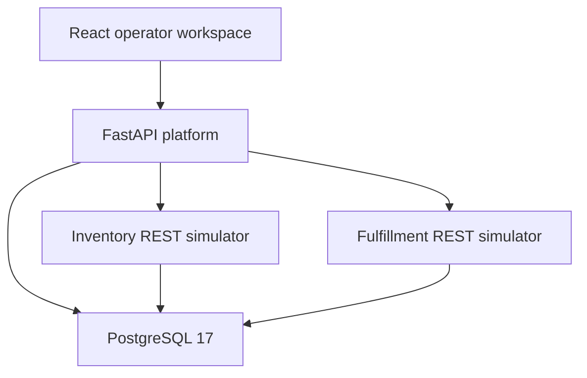

# BridgOps architecture through Stage 5

## Components

The existing modular FastAPI application owns tenant administration, canonical
orders, integration configuration, import tracking, workflow configuration,
execution state, approvals and recovery. React provides the operator workspace.

Inventory and fulfillment are independent FastAPI processes reached through actual
HTTP calls. They use separate provider tables in the same PostgreSQL database to
keep the demonstration lightweight. They do not read platform orders or tenants.
This is an HTTP integration boundary, not independent database infrastructure.

The Vite development proxy forwards /api requests to the platform. Compose publishes
ports only on 127.0.0.1. Alembic runs before the Compose API starts.

## Canonical orders and connectors

`app/connectors` contains a protocol, explicit registry and controlled mapping code.
Shopify-style payloads use id/line_items/price; custom REST uses
reference/products/price_cents; CSV groups flat rows by order reference.
All produce the existing Pydantic OrderCreate schema and use the same order service.

Mappings support dotted dictionary paths, defaults, identifier trimming and exact
Decimal conversion. There is no eval, arbitrary expression execution or dynamic
plugin loading. CSV input is bounded to 256 KiB, 500 rows and 100 order groups.
An invalid item rejects its complete order group; other valid groups are preserved.

Orders have unique (tenant_id, external_order_id), positive quantities, distinct
SKUs per order and optional non-negative prices. Equivalent duplicate submissions
reuse the original order. Conflicting contents return a conflict. Existing order
contents remain immutable. Failed transformations can be corrected and reimported.

Integration updates require the expected configuration version. Import records
persist before processing and preserve a configuration snapshot, digest, source
reference, row numbers and success/failure state. Raw provider payloads and tokens
are not retained. A crash may leave a pending import requiring investigation.

## Workflow definitions and rules

Definitions contain ordered, validated steps: condition, approval, inventory_check,
inventory_reservation and fulfillment_request. Exactly one check/reservation/fulfillment
sequence is required, and approval steps precede reservation. Branches only reference
earlier conditions, so loops and forward references cannot be configured.

Rules compare exact Decimal order totals, quantities, SKU membership and source
fields using explicit operators. Groups support all/any. All configured rule inputs
must be available. Missing prices never silently become zero.

The supported trigger is an explicit order_processing request. Saving or importing
an order does not start execution automatically. The runner resolves an integration
assignment, then a retailer default, then the built-in standard. Disabled assigned
workflows fail selection. The first successful import supplies source provenance.

Each execution snapshots its definition/version, source context and order values.
Changing configuration never changes how a paused execution resumes. Immutable
workflow version rows support inspection of prior configurations.

## Persistence and transaction boundaries

There are 15 application/provider tables plus Alembic's version table. Business
relationships use tenant ownership and composite foreign keys where appropriate.
Tenant filtering is data scoping, not authenticated user authorization.

Concurrency controls:

| Operation | Protection |
|---|---|
| Order creation | Tenant/external-ID uniqueness and specific conflict recovery |
| Initial workflow claim | Order row lock and existing-execution check |
| Inventory reservation | Persistent tenant/key uniqueness; sorted stock row locks |
| Fulfillment request | Persistent tenant/key uniqueness and payload comparison |
| Approval decision | Execution row lock, valid state transitions and decision replay |
| Recovery | Execution lock, request-key replay, attempt uniqueness and ownership token |

A step is committed as running before each HTTP request. No transaction remains
open during the external call. The production session factory uses
expire_on_commit=False. Results and references are committed afterward. Tests assert
transaction boundaries and use real HTTP servers, not only mocked calls.

A completed workflow means the provider accepted fulfillment. It does not prove
shipment or delivery. Reservation success followed by fulfillment failure keeps the
reservation and marks the order as needing attention.

## Approval and failure states

Existing order/workflow/step constraints are preserved. Waiting approvals use
needs_attention with approval_pending, and the approval step is pending. Decisions
persist reason, note, timestamp and an explicitly unverified development operator.
Rejection stops the workflow before stock is reserved.

Known failures and uncertain outcomes are distinguished. A lost/malformed response
to a mutating request becomes an unknown step and attention state. Error categories
include validation_error, insufficient_stock, provider_rejected,
provider_unavailable, timeout_unknown, authorization_error and approval states.
Provider response bodies and credential headers are not exposed as diagnostics.

## Recovery and audit

Manual recovery accepts a request key and a note. Same-key/same-payload requests
return existing execution state; conflicting reuse is rejected. Completed steps
remain intact and new step attempts are appended.

Before retrying a business write, recovery checks the provider's tenant-scoped
idempotency-key lookup. A matching result is verified against tenant, key, items and
fulfillment references, then recorded without repeating the write. Supplied external
references undergo the same validation. No unrestricted mark-completed action exists.
An absent result after plain reconciliation leaves attention state until an explicit
eligible retry. Further submissions stop at the three-attempt limit.

Investigation notes preserve state. Approval decisions and recovery actions produce
audit events with before/after state and development attribution. Invalid source
inputs are corrected and imported as new attempts, without overwriting order history.

A running execution requires 60 seconds without progress before reconciliation.
Each owner has a token. An older runner checks ownership before storing results and
cannot overwrite a newer recovery. Stable provider keys also guard concurrent
business effects. Stale runs without a persisted external step require investigation.

## Security and deliberate limits

This is a trusted-local demonstration. Tenant selection and self-reported operator
names do not establish identity or permissions. Ingestion uses a development token
from the environment, not ordinary integration database fields. Management and
provider demo controls are not safe to expose publicly.

No live provider accounts, payment processing, stock release, fulfillment cancellation,
background queue, Kafka, Kubernetes, Redis, Airflow or cloud deployment are included.
The provider failure simulators are single-worker process-local controls; actual stock,
reservations and fulfillment state are persistent.
